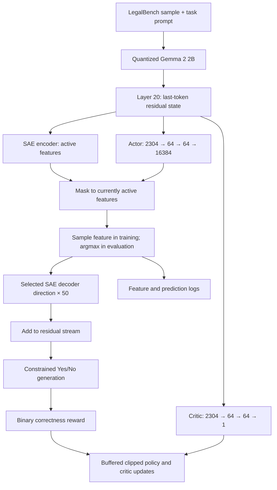

# Architecture

## Components in the notebook

| Component | Responsibility |
| --- | --- |
| `Actor`, `Critic` | Two hidden 64-unit tanh layers; feature logits and scalar value |
| `CRLController.steer` | Build the active-feature mask, choose a feature, record state, add its decoder direction |
| `CRLController.train` | Critic MSE, clipped likelihood-ratio objective, entropy term, gradient clipping |
| `HookWrapper` | Replace the final token residual at layer 20 and preserve the layer output structure |
| `AllowedTokensProcessor` | Restrict generation to the token IDs used for Yes and No |
| `training_eval` | Sample held-out-partition questions, log predictions, features, and critic estimates |
| `checkpoint_model`, `load_checkpoint` | Save/load actor, critic, optimizer state, coefficient, and mask |

The controller resets its mask each pass. This differs from the cumulative expansion described in the literature presentation. The steering coefficient is fixed at `50` in this implementation, despite comments referring to a learned coefficient.

Training settings in the notebook: 4,001 episodes, batch interval 64, one update epoch, actor learning rate 5e-6, critic learning rate 1e-4, clipping 0.2, entropy coefficient 0.01, and evaluation/checkpoint intervals of 250. 
